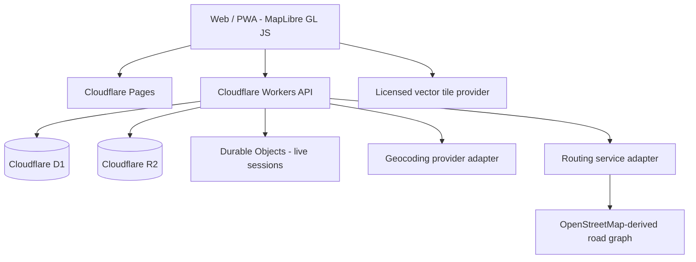

# Lanka Map — Architecture

## 1. Goals

Build a Sri Lanka-first independent mapping platform with map display, search, directions, navigation, place data and live location. Use open standards and replaceable providers. Keep the existing static application working during the transition.

## 2. High-level architecture

## 3. Component responsibilities

### Frontend — Cloudflare Pages
- MapLibre GL JS map renderer.
- Responsive desktop/mobile interface.
- Search suggestions, selected-place details and route display.
- Browser geolocation with explicit permission.
- GPS track capture with clear recording state and export.
- Attribution visible at all times.
- No private service secrets in client-side bundles.

### API gateway — Cloudflare Workers
- Versioned API routes (for example `/api/v1/search`, `/api/v1/route`, `/api/v1/reports`).
- Input validation, rate limiting, request timeouts and safe error responses.
- Provider adapters for geocoding and routing.
- Authentication and authorization for private/user-owned data.
- Observability without logging raw precise coordinates unnecessarily.

### D1
- User profiles and saved places (when accounts are introduced).
- User-submitted road issue reports and moderation state.
- Route/ride metadata and references to stored files.
- Schema migrations and indexes tracked in Git.

### R2
- User-authorized GPX/GeoJSON exports and attachments.
- Versioned map data imports or generated artifacts where appropriate.
- Lifecycle rules and access controls for private uploads.

### Durable Objects
- Short-lived live-location rooms or driver/passenger sessions.
- WebSocket coordination and fan-out.
- Authorization and expiry for every session.
- Do not use as a permanent GPS history database.

### Map data and routing
- MapLibre renders vector/raster tiles; it does not provide map data by itself.
- Use an OSM-derived tile source with an explicit service agreement and appropriate attribution.
- Do not use the public OSM standard tile server as an unrestricted production tile backend.
- Use Valhalla or OSRM as a separately hosted routing engine or a managed service.
- Keep routing behind a provider adapter so the backend can change without rewriting the UI.
- Satellite imagery, street-level imagery and traffic require separate licensed data sources; they are not included in OSM data.

## 4. API boundaries

Initial proposed API contracts (to be implemented and versioned in later commits):

| Endpoint | Purpose | Initial access |
|---|---|---|
| `GET /api/v1/health` | API health and version | Public |
| `GET /api/v1/search?q=` | Sri Lanka-focused place search | Public, rate-limited |
| `GET /api/v1/route?from=&to=&mode=` | Route geometry and summary | Public, rate-limited |
| `POST /api/v1/reports` | Submit a road issue | Authenticated / moderated |
| `GET /api/v1/reports/:id` | Read a permitted report | Policy-controlled |
| `POST /api/v1/tracks` | Store a user-authorized GPS track | Authenticated / private |

All coordinate inputs must be finite and within valid geographic bounds. Sri Lanka-only restrictions must be applied consistently where the feature is explicitly Sri Lanka-scoped.

## 5. Data and privacy principles

- Ask for browser location permission only when the user activates a location feature.
- Explain when recording starts and stops.
- Keep local-only recording behavior until secure account-backed storage is implemented.
- Private tracks must not be publicly addressable.
- Apply retention limits and user deletion/export paths.
- Avoid precise coordinates in routine application logs.
- Treat GPS traces as user-recorded, unverified observations, not authoritative road data.

## 6. Delivery phases

1. Core map foundation: responsive UI, map controls/layers, GPS, search adapter boundary, baseline UAT.
2. Search and routing: geocoding API, directions, alternative routes, route persistence.
3. Navigation: route guidance, rerouting, voice prompts, robust background/location behavior where platform support allows.
4. Advanced data: licensed satellite imagery, place directory, traffic intelligence and map-data update pipeline.
5. Taxi integration: authorized live sessions, passenger/driver tracking and completed-trip route history.

## 7. Key technical decisions

- Keep the current app functional until replacement features pass regression tests.
- Use MapLibre as the renderer, not as a tile or routing provider.
- Prefer vector tiles for styling and zoom behavior; choose providers based on coverage, terms, reliability and cost.
- Keep routing computation separate from Workers.
- Do not promise Google-equivalent satellite, traffic or Street View coverage until data suppliers and licensing are confirmed.
